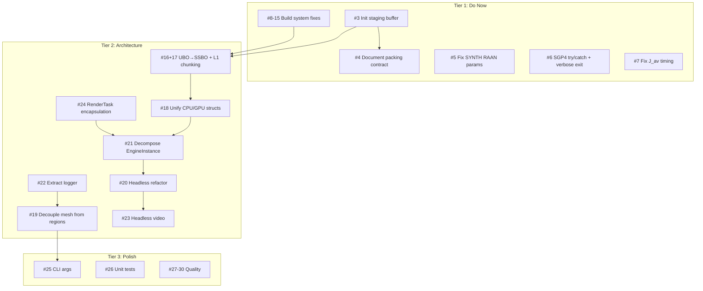

# RSO — Comprehensive Issue List (v2)

> [!NOTE]
> Updated after discussion. Issues re-prioritized into tiers based on your feedback.
> Items marked ✅ are already fixed. Items marked 🚫 are invalidated or deferred indefinitely.

---

## Tier 1 — Correctness & Critical Fixes (Do Now)

These affect simulation results or prevent compilation on other machines.

### 1. ✅ Backward Euler: redundant `Omega *= dt` made the formula wrong for `dt ≠ 1`
**File:** [compute_alpha.slang](file:///home/pasha/build/RSO/RemoteSensingOptimizer/src/rso/shaders/compute_alpha.slang#L111-L115)
**Status:** Fixed — removed the erroneous pre-multiplication.

### 2. ✅ `clipPos.w >= 0.0` allowed division by zero
**File:** [compute_alpha.slang](file:///home/pasha/build/RSO/RemoteSensingOptimizer/src/rso/shaders/compute_alpha.slang#L78-L80)
**Status:** Fixed — changed to strict `clipPos.w > 0.0`.

### 3. First frame reads uninitialized staging buffer → garbage in `J_T` and `J_av`
**File:** [EngineInstance.cpp](file:///home/pasha/build/RSO/RemoteSensingOptimizer/src/rso/EngineInstance.cpp#L447-L450)
**Fix:** Zero-initialize `m_resultStagingBuffer` after creation, or skip readback on the first frame.

### 4. `getInvViewProj` relies on fragile memory layout contract without documentation
**File:** [shared.slang](file:///home/pasha/build/RSO/RemoteSensingOptimizer/src/rso/shaders/shared.slang#L57-L79)
**Fix:** Add detailed comments documenting the GLM column-major ↔ Slang row-major packing contract. Consider renaming the overwritten slots to make the intent explicit.

### 5. SYNTH RAAN parameters are dead code — never passed to generation script
**File:** [src/rso/CMakeLists.txt](file:///home/pasha/build/RSO/RemoteSensingOptimizer/src/rso/CMakeLists.txt) (lines 68-79)
**Fix:** Pass `-DRAAN_START_DEG=${SYNTH_RAAN_START} -DRAAN_SPAN_DEG=${SYNTH_RAAN_SPAN}` in `add_custom_command`, or remove the dead cache variables.

### 6. SGP4 `FindPosition` can throw — crashes the entire run
**File:** [Application.cpp](file:///home/pasha/build/RSO/RemoteSensingOptimizer/src/rso/Application.cpp#L115)
**Fix:** Wrap in try/catch, log verbose explanation of which satellite failed and why (epoch age, TLE quality), then gracefully mark that satellite inactive for the current timestep. Don't silently swallow — output full diagnostic.

### 7. `J_av` and elapsed time calculations are off by `2*dt`
**File:** [Application.cpp](file:///home/pasha/build/RSO/RemoteSensingOptimizer/src/rso/Application.cpp#L204-L236)
`endSimTime` adds 2 extra seconds, then `reportedSimTime` subtracts them — first iteration reports negative time. `J_av / elapsedTime` can divide by negative/near-zero. Clean up the pipeline latency accounting.

### 8. `cmake_minimum_required(VERSION 3.16)` but uses `DOWNLOAD_EXTRACT_TIMESTAMP` (3.24+)
**File:** [CMakeLists.txt](file:///home/pasha/build/RSO/RemoteSensingOptimizer/CMakeLists.txt#L1)
**Fix:** Bump to `cmake_minimum_required(VERSION 3.24)`.

### 9. Shader `DEPENDS` doesn't track `shared.slang` → stale shader binaries
**File:** [src/rso/CMakeLists.txt](file:///home/pasha/build/RSO/RemoteSensingOptimizer/src/rso/CMakeLists.txt)
**Fix:** Add `${CMAKE_CURRENT_SOURCE_DIR}/shaders/shared.slang` to every shader's `DEPENDS` list.

### 10. Add `static_assert` on all GPU struct sizes and alignments
**File:** [BufferStructs.hpp](file:///home/pasha/build/RSO/RemoteSensingOptimizer/src/rso/BufferStructs.hpp#L17-L33)
**Fix:** Add assertions for `AgentData`, `UBO`, `VertexCoords`, `VertexData` — both `sizeof` and `alignof`. Also assert offsets of critical fields (`agents` array offset within `UBO`).

### 11. Duplicate `scripts/embed_spv.cmake` — stale dead copy
**Files:** [scripts/embed_spv.cmake](file:///home/pasha/build/RSO/RemoteSensingOptimizer/scripts/embed_spv.cmake) vs [cmake/embed_spv.cmake](file:///home/pasha/build/RSO/RemoteSensingOptimizer/cmake/embed_spv.cmake)
**Fix:** Delete `scripts/embed_spv.cmake`.

### 12. PGO documentation step 3 is wrong (missing `-DENABLE_PGO_USE=ON`)
**File:** [how_to_build.md](file:///home/pasha/build/RSO/RemoteSensingOptimizer/how_to_build.md)
**Fix:** Correct step 3 to use `-DENABLE_PGO_USE=ON`.

### 13. `SYNTH_SAT_COUNT` default: docs say 100, code says 10
**Fix:** Align documentation with code.

### 14. LTO enabled unconditionally — slows debug builds
**Fix:** Gate behind `CMAKE_BUILD_TYPE` Release/Bench.

### 15. Missing `<numbers>` include in Application.cpp
**File:** [Application.cpp](file:///home/pasha/build/RSO/RemoteSensingOptimizer/src/rso/Application.cpp#L65)
**Fix:** Add `#include <numbers>`.

---

## Tier 2 — Architecture Refactors (Next Sprint)

These are structural improvements that unlock future features. Several issues cluster around the same refactors.

### 16. 🔑 UBO → SSBO for satellite data (removes 64KB limit)
**Files:** [BufferStructs.hpp](file:///home/pasha/build/RSO/RemoteSensingOptimizer/src/rso/BufferStructs.hpp), [EngineInstance.cpp](file:///home/pasha/build/RSO/RemoteSensingOptimizer/src/rso/EngineInstance.cpp), [compute_alpha.slang](file:///home/pasha/build/RSO/RemoteSensingOptimizer/src/rso/shaders/compute_alpha.slang), [shared.slang](file:///home/pasha/build/RSO/RemoteSensingOptimizer/src/rso/shaders/shared.slang)
**Current state:** Satellites are packed into a Uniform Buffer Object. UBO has a max size (typically 64KB), artificially limiting the constellation to 512 agents. Since you learned that SSBO works for the L1 cache trick too, there's no reason to keep UBO for agent data.
**Plan:**
- Move `AgentData agents[MAX_AGENTS]` out of `UBO` into a separate `RWStructuredBuffer` / SSBO
- Keep `UBO` for per-frame globals only (model matrix, vertex count, agent count, time step)
- Update descriptor bindings in `EngineInstance.cpp` and shader `[[vk::binding]]`
- Remove the `MAX_AGENTS` cap from the C++ side (use dynamic sizing)

### 17. 🔑 L1 shared memory chunking — the heart of RSO, currently broken for some GPUs
**File:** [compute_alpha.slang](file:///home/pasha/build/RSO/RemoteSensingOptimizer/src/rso/shaders/compute_alpha.slang#L12)
**Current state:** `groupshared float4x4 s_agentCamera[MAX_AGENTS]` = 512 × 64 bytes = **32 KB** exactly. The Vulkan spec guarantees a minimum of 32 KB shared memory (`maxComputeSharedMemorySize`). But this leaves **zero room** for `s_threadSums` or any other shared variable. Some GPUs (older AMD) have exactly 32 KB, so this is at the bleeding edge.
**Plan:**
- Query `maxComputeSharedMemorySize` at runtime (you already log it!)
- Compute a chunk size: `chunkSize = floor(sharedMemSize / sizeof(float4x4))`
- In the shader, load agents in chunks: outer loop over `[0, agentCount)` stepping by `chunkSize`, inner collaborative load + barrier + inner agent loop
- This enables **unlimited** constellation sizes and works safely on all Vulkan hardware
- Since this data is now in SSBO (issue #16), just change the load source

> [!IMPORTANT]
> Issues #16 and #17 are tightly coupled — do them together as one refactor.

### 18. Unify CPU/GPU struct definitions — single source of truth
**Files:** [BufferStructs.hpp](file:///home/pasha/build/RSO/RemoteSensingOptimizer/src/rso/BufferStructs.hpp), [shared.slang](file:///home/pasha/build/RSO/RemoteSensingOptimizer/src/rso/shaders/shared.slang)
**Current state:** `MAX_AGENTS`, `UBO`, `AgentData`, `VertexCoords`, `VertexData` are defined independently in C++ and Slang.
**Approach options:**
1. **Slang as source of truth** — Slang supports `#include` and preprocessor. Write a `.slang.h` shared header that both C++ and Slang can parse (subset of C syntax: structs, constants, no templates). Slang's preprocessor handles it natively; C++ includes it with a compatibility preamble (`typedef float4 ...` etc.).
2. **Code generation** — A small Python/CMake script reads a YAML/JSON schema and generates both `BufferStructs.hpp` and `shared.slang`.
3. **Pragmatic minimum** — Keep them separate but add `static_assert`s (issue #10) and a comment "MIRROR OF shared.slang" to catch drift at compile time.

Option 3 is cheapest. Option 1 is cleanest. Let's discuss which you prefer.

### 19. Decouple mesh generation from region-of-interest selection
**Files:** [BufferStructs.hpp](file:///home/pasha/build/RSO/RemoteSensingOptimizer/src/rso/BufferStructs.hpp#L151-L251)
**Current state:** `populateMesh()` contains:
- Cube-sphere grid generation (mathematical, reusable)
- Geographic filtering (France / Kyiv / Gaza / Mali — hardcoded)
- Solid angle computation
- `std::printf` logging
- All inline in a header

**Plan:**
- Extract `populateMesh()` into a `.cpp` file
- Separate grid generation from region filtering: `CubeSphere::generate(resolution)` → full grid, then `RegionFilter::apply(mesh, regions)` → subset
- Regions should be a `std::vector<GeoRect>` passed in, not hardcoded
- This also resolves: hardcoded France vs Kyiv issue, and the `std::printf` consistency issue

### 20. Refactor headless vs windowed mode more gracefully
**Files:** [EngineInstance.hpp](file:///home/pasha/build/RSO/RemoteSensingOptimizer/src/rso/EngineInstance.hpp), [EngineInstance.cpp](file:///home/pasha/build/RSO/RemoteSensingOptimizer/src/rso/EngineInstance.cpp), [src/rso/CMakeLists.txt](file:///home/pasha/build/RSO/RemoteSensingOptimizer/src/rso/CMakeLists.txt)
**Current state:** `if constexpr (!Settings::headlessMode)` sprinkled everywhere. Headless binary still links GLFW. Two separate executable targets duplicate most configuration.
**Considerations:**
- For the headless video rendering feature you want (issue #23), you'll need offscreen rendering without a swapchain — this is a new mode between "full GUI" and "pure compute"
- Consider: runtime mode selection instead of compile-time `#ifdef HEADLESS`
- GLFW dependency should be conditional

### 21. `EngineInstance` is a God class — decompose responsibilities
**File:** [EngineInstance.hpp](file:///home/pasha/build/RSO/RemoteSensingOptimizer/src/rso/EngineInstance.hpp)
**After** issues #16-20 are resolved, decompose into:
- `VulkanContext` — instance, device, queues
- `SimulationPipeline` — compute/reduce routines, buffers, UBO management
- `RenderPipeline` — swapchain, render routine, window (optional)
- `SyncManager` — semaphores, fences, frame-in-flight tracking

### 22. Extract logger from Application singleton — create it first
**Files:** [Application.hpp](file:///home/pasha/build/RSO/RemoteSensingOptimizer/src/rso/Application.hpp), [main.cpp](file:///home/pasha/build/RSO/RemoteSensingOptimizer/src/rso/main.cpp)
**Current state:** `ConsoleLogger` lives inside `Application` singleton. Can't log before App is created or after it's destroyed.
**Fix:** Create `ConsoleLogger` in `main()` and pass it down. Replace `std::printf` calls in `populateMesh` with logger calls.

### 23. 🆕 Add headless video rendering capability
**Files:** Engine-wide
**Goal:** Render visualization frames to an offscreen framebuffer and encode to a video file (e.g., via FFmpeg pipe or raw frame dump).
**Approach:**
- Create offscreen `vk::Image` + `vk::Framebuffer` (no swapchain needed)
- Render each frame → readback pixels → write to FFmpeg stdin pipe or save as PNG sequence
- This requires issue #20 (headless refactor) to be done first

### 24. Engine design: `RenderTask` is a public vector on `RenderRoutine`
**File:** [RenderRoutine.hpp](file:///home/pasha/build/RSO/RemoteSensingOptimizer/src/engine/RenderRoutine.hpp) — `std::vector<svk::RenderTask> m_tasks` is public with comment "Temporary Public Access"
**Fix:** Add `addTask()` / `removeTask()` methods, make `m_tasks` private.

---

## Tier 3 — Quality & Polish (Later)

### 25. Add CLI argument parsing
**Files:** [main.cpp](file:///home/pasha/build/RSO/RemoteSensingOptimizer/src/rso/main.cpp), [Settings.hpp](file:///home/pasha/build/RSO/RemoteSensingOptimizer/src/rso/Settings.hpp)
**Blocked by:** Architecture refactor (#19, #20). After regions, TLE source, and mode are decoupled, wire them to CLI args.

### 26. Add unit tests for math functions
Sun position, cube-sphere geometry, solid angle, Euler integration, Jacobian — all need validation against reference values. GoogleTest is already in the build (via SGP4).

### 27. Signal handling for graceful shutdown
Same approach as #6 — verbose output, flush logs, release GPU resources on SIGINT/SIGTERM.

### 28. `std::printf` → ConsoleLogger consistency
**Blocked by:** #22 (logger extraction).

### 29. Set up `.clang-format` and `.clang-tidy`
Standardize code style. Apply incrementally to avoid noisy diffs.

### 30. `FETCHCONTENT_BASE_DIR` in source tree
Move to build directory (CMake default) for cleaner source tree.

---

## 🚫 Invalidated / Won't Fix

| # | Original Issue | Reason |
|---|---------------|--------|
| ~~25~~ | Cross product zero vector at poles | **Invalid** — for any Keplerian orbit, $\vec{v} \perp \vec{r}$ (circular) or never parallel (elliptical). Physically impossible. |
| ~~7~~ | Hardcoded GPU device name | Very low priority, single developer. Will be handled by future CLI args. |
| ~~8,9~~ | Sun elevation / off-nadir commented out | Known development state, not a bug. Will be addressed when architecture supports it. |
| ~~14~~ | `tanHalfFov /= 525` | Valid small-angle approximation, placeholder for current experiment. |
| ~~16~~ | SGP4 fetches GoogleTest unconditionally | Third-party code, can't fix on our side. |
| ~~20~~ | `OmegaStrength` formula | Known simplification, not a priority. |
| ~~24~~ | "Emperor" metaphor | Style preference, not a bug. |

---

## Recommended Execution Order

> [!TIP]
> The critical path is: **Tier 1 fixes → #16+#17 (UBO→SSBO + L1 chunking) → #18 (struct unification) → #21 (decompose God class) → #20 (headless refactor) → #23 (video rendering)**
